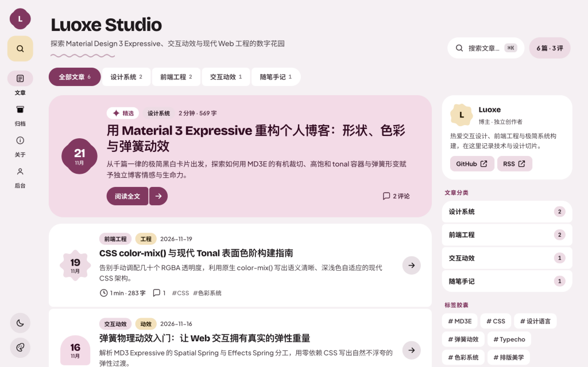
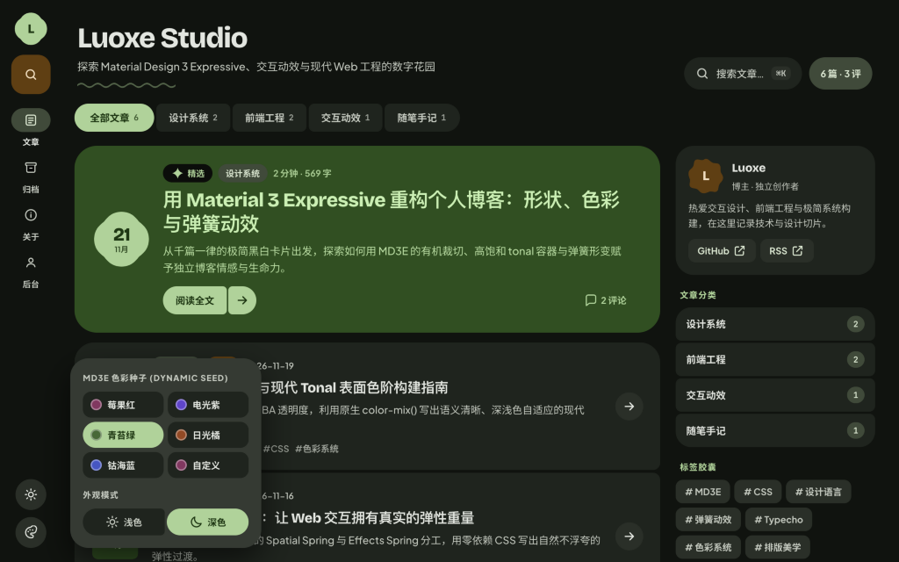
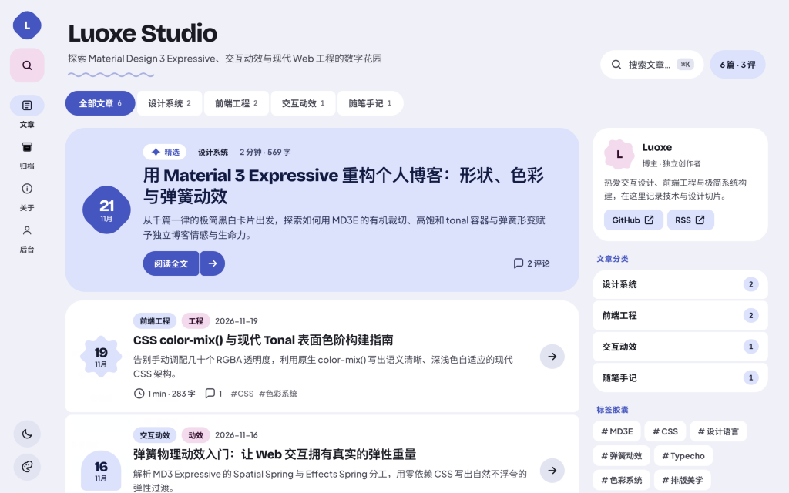
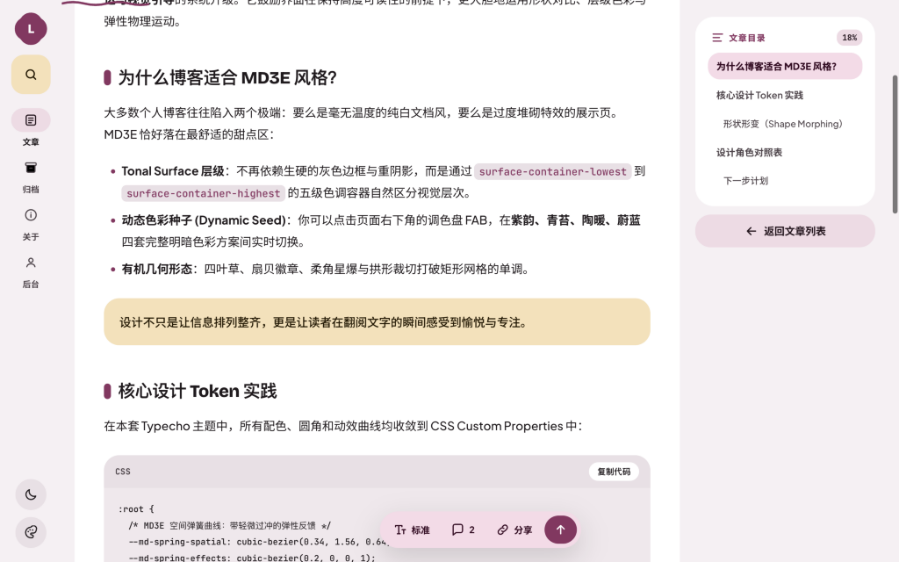
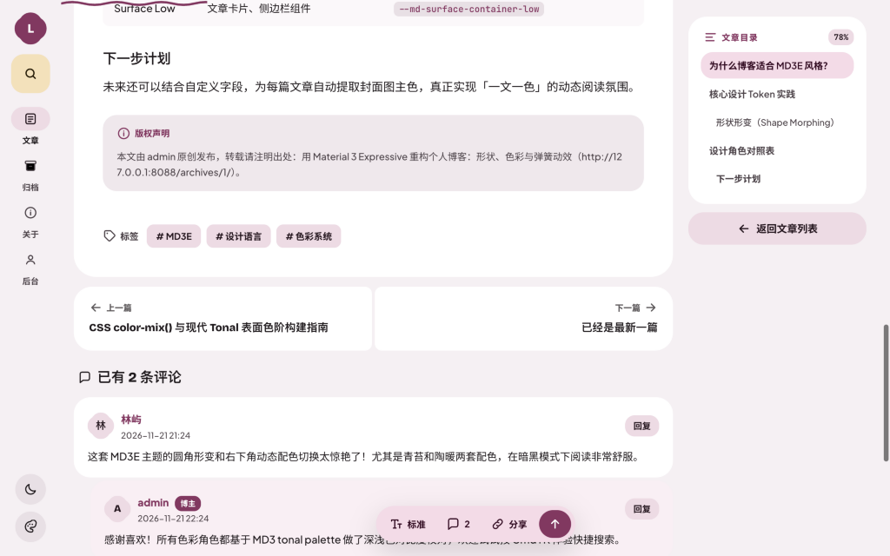
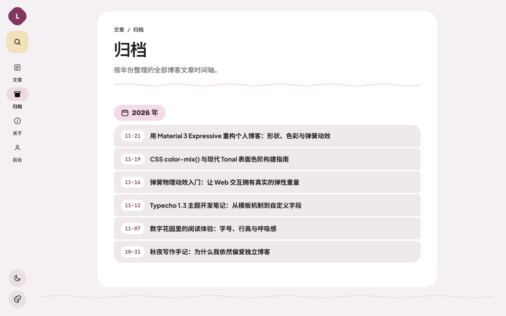
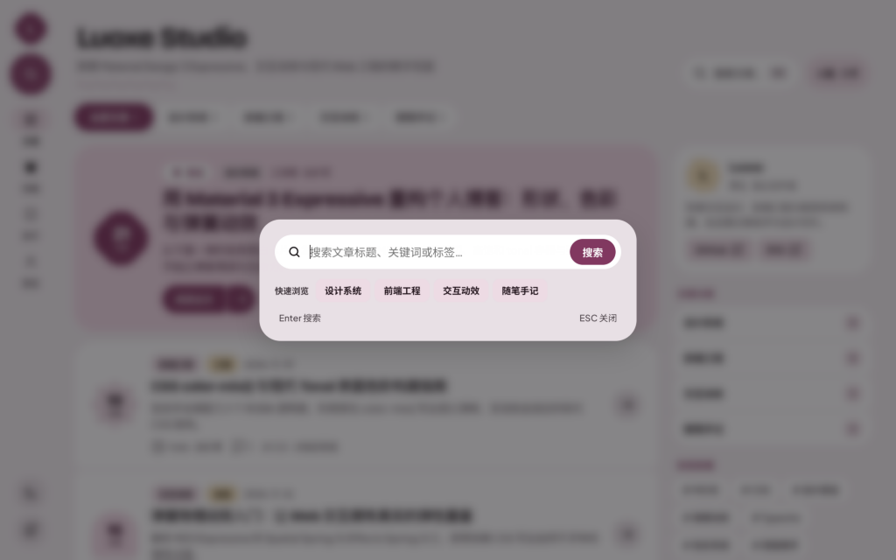
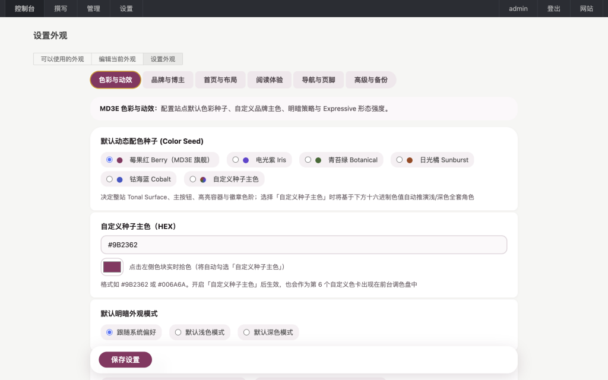
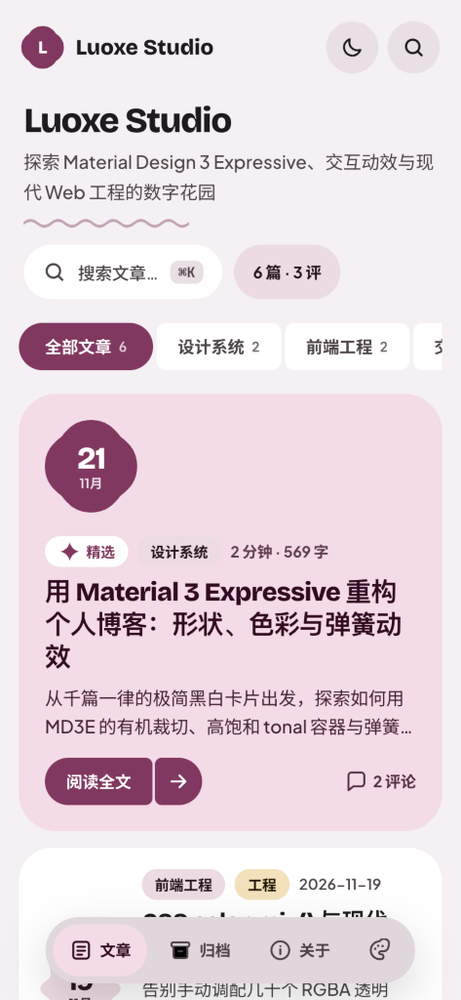

# Material 3 Expressive (MD3E) — Typecho 博客主题

> 一款以**文章阅读流为核心**的 **Material Design 3 Expressive (MD3E)** 风格 Typecho 主题。



---

## 核心特性

- **博客阅读流优先**：摒弃冗余营销大 Hero，首屏即见紧凑报头、连接式分类筛选条、首篇主色导读卡与文章列表。
- **动态色彩种子 (Dynamic Color Seed)**：内置 **莓果红 Berry**、**电光紫 Iris**、**青苔绿 Botanical**、**日光橘 Sunburst**、**钴海蓝 Cobalt** 5 套高饱和浅/深色 Tonal 色阶，外加基于 `color-mix()` 的**任意 HEX 自定义种子主色**实时推演。
- **地道 MD3E 交互组件**：
  - 桌面端常驻 **Material 3 Navigation Rail** + 移动端底部悬浮 **Floating Navigation Dock**
  - **Connected Button Group（连接式分类按钮组）** 与 **Split Button（分裂阅读按钮）**
  - **Android 16 Grouped Surface Containers（分组分段卡片流）**，纯 Tonal 色阶对比，无生硬灰框
  - **6 种 MD3E 有机几何日期戳**（9 瓣曲奇、四叶草、柔角太阳、拱形、菱石、六瓣花）与精确半高半径弹簧形变（零 `0px` 过冲闪烁）
  - **波浪阅读进度条（Wavy Progress Indicator）** 与波浪分隔线
- **沉浸式长文阅读体验**：
  - 自动提取 `H2 / H3` 吸顶目录 TOC，带实时阅读进度百分比与双向滚动精准高亮
  - 底部悬浮 **MD3E Floating Reading Toolbar**（字号切换 / 评论直达 / 分享复制链接 + Snackbar / 返回顶部）
  - 代码块自动识别语言徽标并支持一键复制、正文图片灯箱放大、文末动态版权声明卡片
- **快捷交互与独立模板**：
  - `⌘K / Ctrl+K` 快捷搜索弹窗（内置快速分类跳转胶囊）
  - 整卡点击直达正文（保留内部链接与划词复制）
  - 内置自定义「归档时间轴」独立页面模板（`page-archives.php`）
- **完善的 Typecho 后台外观设置**：6 大分页标签、36 项可配置选项、原生拾色器同步、一键导出/导入 JSON 配置与恢复默认。

---

## 全方位界面演示

### 1. 首页阅读流 & 多套动态配色

<table>
  <tr>
    <td width="50%" align="center">
      
      <br /><sub><b>莓果红 Berry · 浅色模式（默认）</b></sub>
    </td>
    <td width="50%" align="center">
      
      <br /><sub><b>青苔绿 Lime · 深色模式 + 6 色动态调色盘</b></sub>
    </td>
  </tr>
  <tr>
    <td colspan="2" align="center">
      
      <br /><sub><b>钴海蓝 Cobalt · 浅色模式</b></sub>
    </td>
  </tr>
</table>

### 2. 沉浸式文章阅读 & 嵌套评论区

<table>
  <tr>
    <td width="50%" align="center">
      
      <br /><sub><b>波浪阅读进度条 · 代码块复制 · 吸顶目录 TOC · 浮动工具栏</b></sub>
    </td>
    <td width="50%" align="center">
      
      <br /><sub><b>文末版权声明 · 上下篇连接卡 · Android 16 分组嵌套评论</b></sub>
    </td>
  </tr>
</table>

### 3. 归档时间轴 & `⌘K` 快捷搜索弹窗

<table>
  <tr>
    <td width="50%" align="center">
      
      <br /><sub><b>自定义「归档时间轴」页面模板（page-archives.php）</b></sub>
    </td>
    <td width="50%" align="center">
      
      <br /><sub><b>⌘K / Ctrl+K 搜索弹窗 + 分类快速浏览胶囊</b></sub>
    </td>
  </tr>
</table>

### 4. 后台 6 标签页外观设置 & 移动端响应式适配

<table>
  <tr>
    <td width="66%" align="center">
      
      <br /><sub><b>Typecho 后台「外观 → 设置外观」6 分组标签面板与拾色器</b></sub>
    </td>
    <td width="34%" align="center">
      
      <br /><sub><b>移动端（390px）+ 悬浮 Navigation Dock</b></sub>
    </td>
  </tr>
</table>

---

## 安装与启用

### 环境要求
- Typecho `1.2.1+` / `1.3.0+`
- PHP `7.4+`（兼容 PHP `8.x`）

### 安装步骤
1. 将本主题目录 `md3e` 放入 Typecho 的 `usr/themes/` 目录下（确保路径为 `usr/themes/md3e/index.php`）。
2. 登录 Typecho 后台，进入 **控制台 → 外观**，启用 **Material 3 Expressive (MD3E)**。
3. 进入 **外观 → 设置外观**，按需配置配色种子、博主信息、布局与阅读偏好并点击底部 **保存设置**。

### 创建「归档时间轴」页面（可选）
1. 在后台点击 **管理 → 独立页面 → 新增**。
2. 标题填写 `归档`，缩略名填写 `archives`。
3. 右侧 **自定义模板** 选择 `归档时间轴`，点击发布即可自动出现在左侧导航栏中。

---

## 文章自定义字段

撰写或编辑文章时，编辑器下方内置 3 个原生自定义字段（零插件依赖）：

| 字段名 | 说明 |
| :--- | :--- |
| `cover` | 文章封面图 URL（填写后展示在文章卡片右侧及正文顶部，支持点击灯箱放大） |
| `subtitle` | 文章导语 / 摘要（优先于自动截取的正文摘要显示） |
| `badge` | 文章强调徽章文字，例如：`精选`、`深度`、`置顶`、`手记` |

---

## 后台设置外观功能一览（6 分组 · 36 项）

| 标签页 | 包含设置项 |
| :--- | :--- |
| **色彩与动效** | 默认配色种子（5 套预设 + 自定义主色）、HEX 自定义拾色器、默认明暗模式、访客调色盘开关、形状风格（Expressive / 柔和 / 极简）、波浪元素开关、点击水波纹开关 |
| **品牌与博主** | 站点 Logo、Favicon、首页报头自定义标题与简介、文章/评论统计胶囊开关、博主昵称/身份副标/简介/头像/社交链接 |
| **首页与布局** | 首篇导读卡形态（高亮主色卡 / 统一分组流）、连接式分类筛选条开关、几何日期戳开关、列表摘要字数、侧边栏开关（双栏 / 单栏）、6 项侧边栏模块勾选 |
| **阅读体验** | 默认正文字号（紧凑 / 标准 / 大号）、吸顶目录 TOC 开关、底部浮动阅读工具栏开关、6 项文章元信息开关、文末动态版权声明（支持 `{author}` `{title}` `{url}`） |
| **导航与页脚** | 左侧 Navigation Rail 附加自定义链接、导航栏登录入口开关、页脚文字、ICP 备案号与跳转链接 |
| **高级与备份** | 自定义附加 CSS、`<head>` 头部代码、`</body>` 底部代码、一键导出/导入 JSON 配置、恢复出厂默认值 |

---

## 目录结构

```text
usr/themes/md3e/
├── index.php               # 首页文章流
├── archive.php             # 分类 / 标签 / 搜索 / 日期归档视图
├── post.php                # 文章详情页（目录、版权卡、浮动工具栏）
├── post-card.php           # 复用文章卡片局部模板（导读卡 / 分组行）
├── page.php                # 独立页面模板
├── page-archives.php       # 自定义模板：归档时间轴
├── header.php              # 头部元信息、6 种 SVG clipPath、左侧 Navigation Rail
├── footer.php              # 页脚、移动端 Dock、动态调色盘、搜索弹窗、灯箱、Snackbar
├── sidebar.php             # 右侧紧凑分组侧边栏
├── comments.php            # 自定义 threadedComments 分组嵌套评论
├── 404.php                 # 404 引导页
├── functions.php           # 模块化入口（加载 inc/*）
├── inc/
│   ├── helpers.php         # 默认配置、自定义色阶生成、阅读统计与工具函数
│   ├── icons.php           # 内联圆角 SVG 图标库
│   └── config.php          # Typecho 后台 themeConfig() 与 themeFields()
├── assets/
│   ├── css/md3e.css        # 完整 MD3E 设计 Token、5 套明暗色阶与组件样式
│   ├── js/md3e.js          # 配色/深浅色、水波纹、搜索、目录高亮、字号/复制/灯箱
│   └── admin/
│       ├── settings.css    # 后台外观设置分组卡片样式
│       └── settings.js     # 后台标签切换、拾色器同步、JSON 备份导入与重置
├── docs/screenshots/       # README 全套演示截图
├── LICENSE                 # MIT License
└── screenshot.png          # Typecho 外观管理缩略图
```

---

## 作者与开源许可

- **作者**：爅峫（洛汐聚合体 / youshen2）
- **开源协议**：本主题遵循 [MIT License](LICENSE) 开源协议，欢迎自由修改与二次开发。
